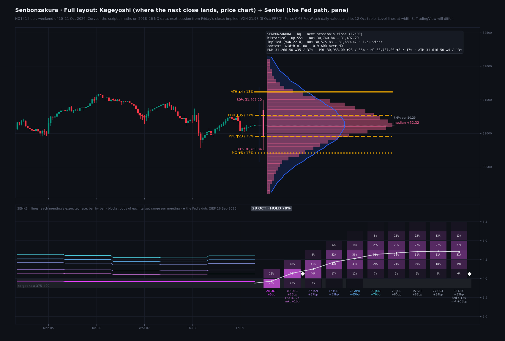
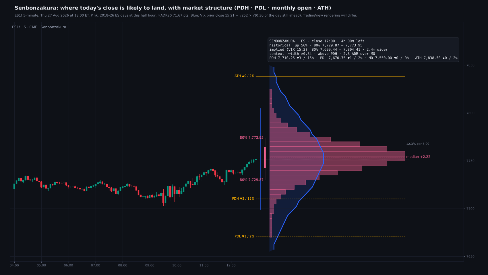
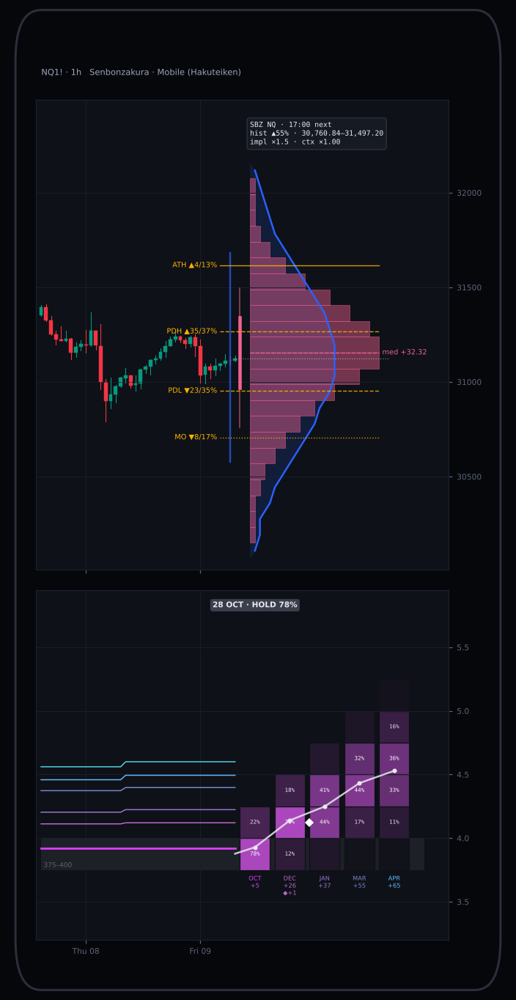

# Senbonzakura

**Close Probability Curves & the Fed Path**

TradingView indicator, Pine Script v6. Open source under the Mozilla Public License 2.0.

*Mock-up of how it looks on the chart.*

**Senbonzakura** draws two probability distributions. **Kageyoshi** shows where today's close is likely to land on Nasdaq, S&P and Russell futures, as sideways curves to the right of price: a historical curve from eight years of 1-minute data next to the curve the options market implies. **Senkei**, in the indicator's pane, shows the Fed path the market prices from 30-day fed funds futures, meeting by meeting. *Both are maps of how far things usually travel, not calls on direction.*

Inspired by Interactive Brokers' Probability Lab (the Probability Distribution Builder in TWS), which sets your own distribution beside the market-implied one, and by CME Group's FedWatch Tool, which turns fed funds futures into FOMC odds. Senbonzakura is written from scratch and is not affiliated with either company.

## Kageyoshi · where today's close lands (price chart)

- **Pink bars, historical:** for every trading day Jan 2018 – Oct 2026, the close minus the price at each half hour from 18:00 ET, measured in ADR20 (the average high − low of the previous 20 days). The script takes the current half hour's distribution, scales it to today's ADR20 and centres it on the last price. The curve narrows as the day runs out.
- **Blue bell, options-implied:** VIX for ES, VXN for NQ, RVX for RTY. One day's move is the index ÷ √252, spread through the day by the share of the day's variance still ahead (measured from the same data). It is drawn as a lognormal around price.
- **Bands:** the historical 25–75% (thick) and 10–90% (thin) ranges, the historical median (dashed), and the implied 10–90% range (blue).
- **Close:** the CME trading day's close (17:00 ET, the daily candle) or the RTH close (16:14 bar). After the close, and while the market is shut, the curves show the next session from the last price.
- **Header:** the chance of closing up, both 80% ranges, how much wider the implied curve is, the context multiplier, and the four levels below.

## Market structure

The prior day's high and low (**PDH**, **PDL**), the month's open (**MO**) and the all-time high (**ATH**) are drawn across the curves. Each carries the odds of the close finishing beyond it, historical / implied, e.g. *PDH ▲35 / 37%*. Their colour and line width are adjustable.

Where price sits against these levels changes **how far** the close usually lands, not **which way**. The four were fitted together, and only effects with p < 0.05 that sat on the same side in both 2018–24 and 2025–26 are applied:

- **below PDL:** wider, ×1.13–1.30;
- **under the month's open:** wider, ×1.05–1.19 for each ADR below it (capped at 3 ADR);
- **above PDH:** narrower, ×0.84–0.90 (NQ from 09:30, ES from 12:00);
- **over the month's open:** small effects, narrower on ES overnight (×0.93 per ADR) and slightly wider on NQ in the afternoon (×1.05);
- **within half an ADR of the ATH after 12:00:** narrower, ×0.87 (NQ, ES).

RTY keeps only the PDL and month's-open effects. Shifts in direction did not hold anywhere, so the centre of the curve is never moved.

## Senkei · the Fed path (pane)

- Seventeen monthly **CBOT 30-day fed funds futures** are read live. Each settles to 100 − the month's average effective fed funds rate. A decision takes effect the next day, so a meeting on day d of an N-day month splits the month d / N − d. Meetings are chained the way CME FedWatch does it, then combined as a probability tree.
- **Checked against CME's own FedWatch page for 12 Oct 2026:** within 0.06 percentage points for every meeting shown.
- **Right of the last bar:** one column per upcoming meeting, with a block for each 25bp target range shaded by its odds, the expected path through the columns, and a headline such as *28 OCT · HOLD 78%*.
- **Left of the last bar:** the expected rate after each of the next six meetings, worked out bar by bar, so you can see how the market's path has moved. A line's colour matches its date under the columns.
- **◆ Fed dots:** the median year-end rate from the Fed's dot plot (Summary of Economic Projections), beside each year's last meeting. The market's gap to it is shown under the column.

## What the tests showed

- **Calibration:** curves built on 2018–24 and checked on 2025–26, with context. The 80% band caught **82–84%** of closes across NQ, ES and RTY.
- **Context fixes the drawdown days:**
  - below PDL, the 80% band went from 73% to **79%** of closes on NQ and from 70% to **76%** on ES;
  - far under the month's open, from 70% to **78%** on NQ and from 67% to **76%** on ES.
- **Implied vs what followed:** on ES the VIX curve ran **1.3×** wider than the historical one at the open and **1.55×** by 14:00. Its 80% band held 90% of closes. That is the volatility risk premium: options usually price in more movement than arrives. VXN and RVX were not back-tested.
- **Shape:** real closes bunch near the price more than a bell does, with fatter tails, most of all in the afternoon. That is why the pink and blue curves differ in shape as well as width.
- **Drift:** NQ's median close sits about 0.07 ADR above the 18:00 price, the carry drift of an index future.

## Layouts

**View** sits at the top of the settings: Pane (Senkei or empty), Theme, Layout, Text and Kageyoshi on the price chart.

**Desktop** shows every label, up to ten Fed meetings and long curves.

**Mobile** (Hakuteiken) folds everything for a phone screen:

- curves 26 bars long with 24 bins;
- a three-line header;
- short level labels;
- five Fed meetings in narrower columns, with month-only dates and the ◆ gap under year-end columns.

Full wording stays in the tooltips. Chart layouts sync across devices, so use a separate layout on the phone with *Layout = Mobile*.

## How to use

- Built for **NQ / MNQ**, **ES / MES** and **RTY / M2K** (continuous or front month). Other symbols use NQ statistics and the header says so.
- Kageyoshi suits 1 to 60-minute charts. Senkei works on any timeframe.
- Switch Senkei off to keep only the curves on the price chart; the pane can then be made small.
- Bar replay works: "now" never runs past the last bar.

## Data and method

- 1-minute data, Jan 2018 – Oct 2026 (ES to Aug 2026): 2,041 NQ, 2,117 ES and 2,157 RTY complete trading days.
- **ADR20** = mean (high − low) of the previous 20 trading days. The next-session curve includes the day just finished.
- Higher-timeframe values use the [1] offset with lookahead on (completed days only). The day's high and the month's open are read only on the last bar.
- The all-time high is TradingView's highest daily high before today, plus today's high so far.
- FOMC dates are loaded to Dec 2027; add new years in S_FOMC. Update the dot-plot inputs after each SEP (March, June, September, December).
- Data requests: 17 ZQ months plus 5 others, out of the 40 allowed.

## Why the names

Senbonzakura, Byakuya's blade, scatters into a thousand petals. **Kageyoshi**, its bankai, is the full spread of outcomes. **Senkei** lines the blades up in rows, as the Fed's meetings line up in columns. **Hakuteiken** folds every blade into one sword, the mobile layout. Part of the Hueco Mundo collection.

## Limitations

*These are historical frequencies and market-implied odds, not guarantees or signals.*

- The implied curve is a lognormal with no skew.
- FOMC, CPI and NFP days usually run wider than the all-days curve.
- TradingView delays CBOT and CBOE data without the matching subscriptions. When ZQ contracts are missing or stale, Senkei can differ from CME's page.
- Nothing here is financial advice.

## Add it to TradingView

1. In TradingView, open the **Pine Editor** (bottom panel).
2. Copy the contents of `Senbonzakura.pine` into a new script.
3. **Save**, then **Add to chart**.

## More screenshots

## License

Mozilla Public License 2.0, see [LICENSE](LICENSE). © Unclehk2000.

*Historical frequencies, not guarantees. Nothing here is financial advice.*
